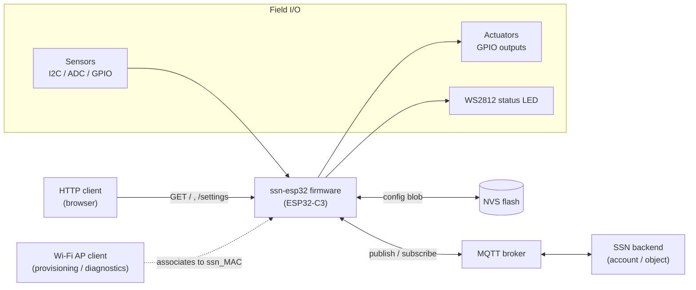
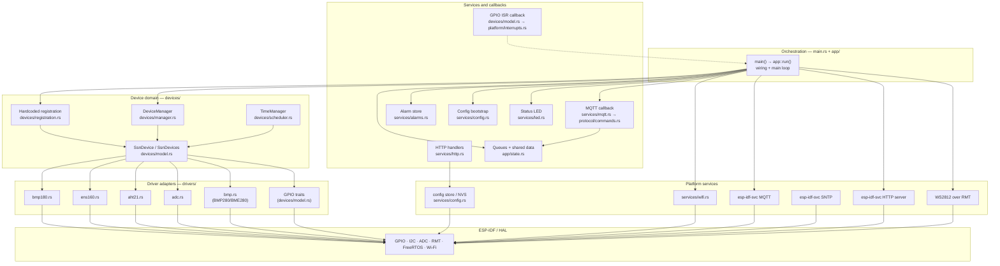
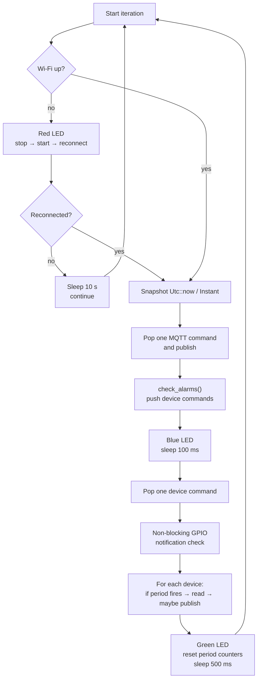
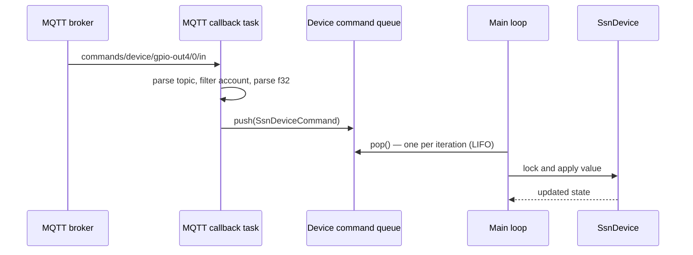

# ssn-esp32 Architecture

> **Status: DRAFT**  
> This document is derived from a static read of the codebase on **2026-11-17**. It describes
> **what the firmware does today**, not a target design. Sections marked *"Gap"*, *"Risk"* or
> *"Open question"* are candidates for follow-up. When the code and this document disagree,
> the code wins — please update this file in the same change that alters the architecture.
>
> **Scope:** the Rust firmware in this repository (ESP32-C3), its runtime structure, protocols,
> configuration, and known limitations. Hardware schematics and the SSN backend are out of scope.

---

## 1. Purpose

`ssn-esp32` is a single-binary firmware for an ESP32-C3 sensor node. The node:

- reads local sensors over I2C, ADC, and GPIO;
- publishes sensor channels to an MQTT broker using the SSN topic hierarchy;
- accepts MQTT commands to drive GPIO outputs and update device state;
- maintains a Wi-Fi **station + access point** (AP) simultaneously;
- synchronizes wall-clock time over SNTP;
- serves a small HTTP page exposing its configuration;
- reports coarse status on a WS2812 RGB LED;
- stores its configuration in NVS flash.

It is a **blocking, single-main-loop** design with no async runtime. MQTT events, GPIO
interrupts, and HTTP requests are handled by ESP-IDF tasks/callbacks and communicate with the
main loop through shared `Arc<Mutex<...>>` queues and an interrupt `Notification`.

### Current non-goals

OTA updates, secure provisioning, TLS, local time-series storage, power management, and a
machine-readable local API are **not implemented**.

---

## 2. System context



The firmware identifies itself with the factory base MAC address. The MAC becomes the
`ssn_id`, part of the AP SSID, and part of the MQTT client ID.

---

## 3. Platform and build

| Item | Value |
|---|---|
| MCU | ESP32-C3 (RISC-V `rv32imc`), set in `Cargo.toml` `[package.metadata.esp-idf]` and `.cargo/config.toml` |
| Rust target | `riscv32imc-esp-espidf` |
| Rust toolchain | `nightly` + `rust-src`, `build-std = ["std", "panic_abort"]` |
| ESP-IDF | `v5.3.2` via `esp-idf-sys` 0.36 / `embuild` 0.33 (`build.rs`) |
| Crate | Binary-only `ssn-esp32`, edition 2021, declared `rust-version = "1.77"` |
| Profiles | `release`: `opt-level = "s"`; `dev`: debug symbols + `opt-level = "z"` |
| Features | `default = []`; `experimental` forwards to `esp-idf-svc/experimental` |
| sdkconfig | `CONFIG_ESP_MAIN_TASK_STACK_SIZE=8000`; everything else ESP-IDF defaults |
| Runner | `espflash flash --monitor` |
| License | Apache-2.0 |

Build and flash:

```bash
cargo build --release
# or: scripts/build.sh [debug|release]

espflash flash target/riscv32imc-esp-espidf/release/ssn-esp32 --monitor
# or: scripts/flash.sh [debug|release]
```

The dev container and VS Code tasks wrap the same scripts. Wokwi is mentioned in
`docs/README.md`, but no `wokwi.toml` is present in this snapshot.

---

## 4. High-level structure



### Runtime model

| Context | Executes | Interaction with shared state |
|---|---|---|
| **Main task** | `app::run()` init, then an infinite loop; `devices::manager::DeviceManager::process_all_devices` | Owns the device list; locks each `SsnDevice` while reading; drains command queues |
| **MQTT client task** | `services::mqtt::start` callback → `protocol::commands::handle_message` | Parses topics, pushes `SsnDeviceCommand` / `SsnMqttCommand`, reads `shared_data`; may read NVS for the `get` command |
| **GPIO interrupt** | `PinDriver::subscribe` callback in `devices/model.rs` → `platform/interrupts.rs` | Increments atomics, locks the per-pin counter map, notifies the main task |
| **HTTP server task** | `services/http.rs` handler closures | Reads captured `app_config`; no shared mutable state |
| **FreeRTOS timers/drivers** | ESP-IDF internals | N/A |

There is **no `async` executor**, no `tokio` (commented out in `Cargo.toml`), and no worker
thread pool. Delays use `FreeRtos::delay_ms` or `std::thread::sleep`.

---

## 5. Module map

The source tree follows the target layout from §20:

```text
src/
  main.rs            # entry point + module wiring + reboot loop
  app/               # lifecycle, loop, publish policy, shared state, helpers
  devices/           # model, registration, manager, scheduler
  drivers/           # sensor/bus adapters
  protocol/          # topics, commands, payload types
  services/          # config, wifi, mqtt, http, alarms, led
  platform/          # shared I2C, mutex recovery, GPIO interrupts
```

| Module | Responsibility | Status in runtime |
|---|---|---|
| `main.rs` | Entry point and module wiring; reboots on `app::run()` error | **Active** (~34 lines) |
| `app/mod.rs` | Initialization order and the main loop | **Active** |
| `app/state.rs` | Shared aliases (`SharedSensorData`, command queues), queue helpers | **Active** |
| `app/publish.rs` | `calculate_percentage_change`, `handle_sensor_value_update` publish policy | **Active**; many commented-out channel helpers |
| `app/helpers.rs` | Extracted MQTT-command, alarm, GPIO-notification, and LED helpers | **Scaffold** — compiled but not called |
| `devices/model.rs` | `SsnDevice` wrapper, `SsnDevices` enum, `SsnSensorPeriod`, shared-device helpers, GPIO traits + `PinDriverBasicInput` impl, `DeviceType` / `DeviceConfig` | **Active** |
| `devices/registration.rs` | Hardcoded device set (GPIO, ENS160, BMP180) | **Active** |
| `devices/manager.rs` | Single device sampling/publishing path for every `SsnDevices` variant; read-failure degraded mode | **Active** |
| `devices/scheduler.rs` | Fast/Middle/Slow sampling scheduler | **Active** |
| `drivers/adc.rs` | ADC1 one-shot adapter + `AdcReaderTrait` | Instantiation commented out |
| `drivers/aht21.rs` | AHT21 adapter over `ahtx0` | Instantiation commented out |
| `drivers/bmp.rs` | BMP280/BME280 adapter over `bmpe280` | Wrapper exists; `SsnDevices::Bmp` logs-and-skips |
| `drivers/bmp180.rs` | BMP180 adapter over `bmp180-driver` | Active when sensor init succeeds |
| `drivers/ens160.rs` | ENS160 adapter over `ens160` crate | Active when sensor init succeeds |
| `protocol/mod.rs` | `ValuesDev` legacy payload struct | Unused |
| `protocol/topics.rs` | Topic builders, topic/token parsers, `fill_device_types_map` | **Active** (topic build/parse); `fill_device_types_map` unused |
| `protocol/commands.rs` | Inbound command/topic parsing, typed `CommandError`, queueing | **Active** |
| `services/config.rs` | `Config` schema, `Settings`, NVS load/save/defaults, HTML `Display`, reset path, identity overrides | **Active** |
| `services/wifi.rs` | STA+AP setup, initial connect with scan/retry, connection check | **Active** |
| `services/mqtt.rs` | Broker/client configuration, client creation, callback dispatch, subscriptions, retained `status/start` | **Active** |
| `services/http.rs` | `/` and `/settings` handlers and HTML templates | **Active** |
| `services/alarms.rs` | `Alarm` store, `add_alarm`, `check_alarms` | **Active** |
| `services/led.rs` | `Colors` and the WS2812 status LED helper | **Active** |
| `platform/i2c.rs` | `SharedI2c(Arc<Mutex<I2cDriver>>)` adapter | **Active** |
| `platform/interrupts.rs` | GPIO interrupt counters, `record_interrupt` / `take_pin_count` | **Active** |
| `platform/mod.rs` | `lock_recover` mutex-poisoning recovery | **Active** |

---

## 6. Boot and initialization sequence

`app::run()` runs from `main()`; it returns only on error, after which the firmware calls
`esp_restart()`. Initialization order:

1. `esp_idf_svc::sys::link_patches()` and `EspLogger::initialize_default()`.
2. Create shared runtime state (`app::state`): sensor-data map, device-command queue,
   MQTT-publish queue, and the GPIO `Notification`.
3. Take peripherals.
4. Configure the settings-reset button: **GPIO8 input with pull-up**, 100 ms settle.
5. Create the WS2812 driver on **GPIO10 / RMT channel 0** (`services::led`).
6. Open the default NVS partition, namespace `ssn_ns`, and construct `Settings`
   (`services::config::open_settings`).
7. If GPIO8 is low at boot, write defaults **and then overwrite them with a hardcoded test
   JSON configuration** (see [§15](#15-configuration-and-persistence)).
8. Load `Config` from NVS (`services::config::load_config`); NVS errors propagate and reboot
   instead of panicking.
9. Override identity fields in memory:
   - `account = "3"`, `object = "2"`;
   - `ssn_id = MAC`;
   - `ssn_wifi_ssid = "ssn_<MAC>"`, `ssn_wifi_pass` set to a hardcoded default;
   - `mqtt_client_id = "ssn_esp_<MAC>"`.
10. Set the LED **yellow**, then initialize Wi-Fi in **Mixed** mode (station + AP). On failure:
    red LED, error propagates, firmware reboots.
11. Start SNTP (`EspSntp::new_default()`); log local time using the hardcoded `DEF_TZ = +3`;
    set the LED **green**.
12. Initialize **I2C0** on **SCL=GPIO0, SDA=GPIO1 at 400 kHz** and wrap it in
    `SharedI2c(Arc<Mutex<I2cDriver>>)` (`platform::i2c`).
13. Register devices (`devices::registration`):
    - GPIO outputs on GPIO3, GPIO4, GPIO5 (`gpio-out3/4/5`);
    - GPIO input on GPIO6 (`gpio-in6`, any-edge, pull-up);
    - ENS160 (`ens160-test`) if initialization succeeds;
    - BMP180 (`bmp180`) if initialization succeeds.
    - AHT21, ADC, `StoreInt`, and GPIO7 are present in code but commented out.
14. Add **two hardcoded alarms** for 14:45 and 14:46 `UTC+3` on 2025-08-02, each 10 s, driving
    `gpio-out4` and `gpio-out5` (`services::alarms`).
15. Create the MQTT client and callback (`services::mqtt`); sleep 6 s; subscribe to topics;
    publish a **retained** `status/start` message containing the client ID.
16. Start the HTTP server (default port 80) with `/` and `/settings` (`services::http`).
17. Enter the main loop (`devices::manager::DeviceManager` + `devices::scheduler::TimeManager`).

**Failure policy:** peripheral, NVS, and Wi-Fi errors abort startup and reboot; sensor
initialization errors are logged and the node continues without that sensor.

---

## 7. Core data model

### 7.1 Configuration

`settings::Config` is a flat JSON object persisted in NVS:

```jsonc
{
  "account": "3",
  "object": "2",
  "ssn_id": "AA:BB:CC:DD:EE:FF",
  "mqtt_host": "192.168.1.10",
  "mqtt_user": "user",
  "mqtt_pass": "***",
  "wifi_ssid": "uplink-ssid",
  "wifi_psk": "***",
  "mqtt_client_id": "ssn_esp_AA:BB:CC:DD:EE:FF",
  "ssn_wifi_ssid": "ssn_AA:BB:CC:DD:EE:FF",
  "ssn_wifi_pass": "***",
  "devices": [ /* DeviceConfig objects */ ]
}
```

`Config::devices` is parsed and stored but **never used to construct devices**. Device
registration is hardcoded in `devices/registration.rs`.

### 7.2 Device configuration (declared, not applied)

`DeviceConfig` (`devices/model.rs`) anticipates a config-driven model:

| Field | Intended use | Applied today? |
|---|---|---|
| `dev_id`, `device_type` | identity and variant selection | No — runtime IDs differ |
| `period` (`"Fast"`, `"Middle"`, `"Slow"`) | sampling cadence | No — no string→enum mapping |
| `is_active`, `is_paused` | enable/disable | No — never read |
| `temperature_delta_over`, `pressure_delta_over`, `humidity_delta_over` | spike thresholds | No |
| `co2eq_delta_over`, `tvoc_delta_over`, `aqi_delta_over` | spike thresholds | No |
| `delta_over` | generic spike threshold | No |
| `gpio_pin`, `interrupt_type`, `pull_type`, `initial_state` | GPIO setup | No |
| `adc_channel`, `voltage_reference` | ADC setup | No |
| `i2c_address` | sensor address | No |
| `store_keys` | `StoreInt` channels | No |
| `description`, `unit`, `min_value`, `max_value` | metadata | No |

### 7.3 Runtime device model

```rust
SsnDevice {
    dev_id: String,
    period: SsnSensorPeriod,   // Fast | Middle | Slow
    is_active: bool,           // stored, not enforced
    is_paused: bool,           // stored, not enforced
    device: SsnDevices,        // variant carrying state + driver handle
}
```

`SsnDevices` variants and their logical channels:

| Variant | State held | Channels published | Notes |
|---|---|---|---|
| `Bmp180` | temp, pressure, altitude, deltas, timestamps | `0` temperature, `1` pressure | Altitude computed but not published |
| `Ens160` | CO₂eq, TVOC, AQI, deltas, timestamps | `0` CO₂eq, `1` TVOC, `2` AQI | `DataNotReady` becomes `(-1, -1, -1)` |
| `Aht21` | temp, humidity, deltas, timestamps | `0` temperature, `1` humidity | Not instantiated in this snapshot |
| `Adc` | raw, mV, delta, timestamps | `0` voltage, `1` raw | Not instantiated |
| `StoreInt` | `HashMap<String, i32>` + per-key timing | one topic per map key | Not instantiated |
| `GpioInput` | level, counter, pull/interrupt config | `0` level, `1` interrupt counter | Active on GPIO6 |
| `GpioOutput` | level | none | Command-driven only |
| `Bmp` | BMP280/BME280 measurements | — | Logs-and-skips; not instantiated |

Shared aliases in `app/state.rs`:

```rust
type SharedSensorData        = Arc<Mutex<HashMap<String, Vec<f32>>>>;
type SharedSsnDevice         = Arc<Mutex<SsnDevice>>;
type SharedSsnDeviceCommand  = Arc<Mutex<Vec<SsnDeviceCommand>>>;
type SharedSsnMqttCommand    = Arc<Mutex<Vec<SsnMqttCommand>>>;
```

---

## 8. Main loop



Key properties:

- The loop itself stays in `app/mod.rs`; the device pass is
  `devices::manager::DeviceManager::process_all_devices`.
- **One command per loop.** Both the MQTT-publish queue and the device-command queue are
  drained one item at a time. The queues are `Vec::pop()` (LIFO).
- **Sequential device reads.** Each device is locked, sampled, and published in order.
- **Blocking delays.** 100 ms before command handling, 500 ms between measured devices, and
  500 ms at the end of each iteration. With several active sensors, a "Fast" cycle is on the
  order of seconds, not 100 ms.
- **Blocking work while holding a device lock.** Sensor reads, MQTT enqueue, and the 500 ms
  inter-device delay all happen under the per-device `Mutex`.
- **`is_active` / `is_paused` are ignored**; every registered device is processed.

### Sampling periods

| Period | Intended cadence | Implementation |
|---|---|---|
| `Fast` | every loop | `TimeManager::should_measure` returns `true` unconditionally |
| `Middle` | ~20 s | `MIDDLE_LOOP_PERIOD_MS = 20_000`; counters reset at end of loop |
| `Slow` | ~60 s | `SLOW_LOOP_PERIOD_MS = 60_000`; counters reset at end of loop |

`devices::manager::MAX_PERIOD_REFRESH_MQTT = 60` seconds forces a publish even when the value is
unchanged.

---

## 9. Publish policy

All sensor channels go through `app::publish::handle_sensor_value_update` (called from
`devices/manager.rs`). Simplified pseudocode:

```text
if first_value (last_sent_value is None)
   OR change_pct >= delta_threshold
   OR since_last_update > 60 s:
    baseline = last_sent_value.unwrap_or(current_value)

    if delta_over is set AND abs(pct(current, baseline)) >= delta_over:
        last_sent_value = current_value      // adopt the jump as the new baseline
        return                               // suppress publication

    publish(current_value as text)
    last_update = now
    last_sent_value = current_value
```

Consequences:

- The first sample of every channel after boot is published immediately (`last_sent_value`
  starts as `None`). This replaces the old "timestamp 30 years in the past" initialization,
  which underflowed `Instant` on ESP-IDF.
- `delta` is the **minimum positive percentage change** needed to publish before the 60 s
  refresh. Negative changes do not satisfy `change_pct >= delta` unless the refresh timer
  expires.
- `delta_over` acts as a **spike suppressor**: unusually large jumps are not published and
  become the new baseline.
- `StoreInt` and the GPIO interrupt counter now persist their per-key/`last_sent` bookkeeping,
  so the first-value and 60 s rules apply to them as well.
- Payloads are **bare scalar text** produced by `Display` (e.g. `23.41`), not JSON.
- Publishes use **QoS 1 (`AtLeastOnce`)**, **not retained**.
- Errors from `enqueue` are discarded by callers (`let _ = ...`), so a failed publish does not
  propagate to the main loop.

---

## 10. Sensors and driver adapters

| Device | Bus / pins | Adapter | Behavior | Status |
|---|---|---|---|---|
| BMP180 | I2C (driver default address) | `drivers::bmp180::BMP180Sensor` | `check_connection`, `initialize`, `read_all(UltraHighResolution)` → `(temp °C, pressure Pa, altitude m)` | Active if present |
| ENS160 | I2C address `0x53` | `drivers::ens160::ENS160Sensor` | Reads firmware version, resets, enters operational mode; returns CO₂eq/TVOC/AQI | Active if present |
| AHT21 | I2C | `drivers::aht21::AHT21Sensor` | Calibrates, then measures temperature/humidity | Driver ready; instantiation commented out |
| ADC | ADC1 one-shot | `drivers::adc::AdcReader` | `DB_11` attenuation; raw → `raw * 2500 / 4095` mV | Driver ready; instantiation commented out |
| BMP280 / BME280 | I2C | `drivers::bmp::BMPSensor` | Temperature, pressure, optional humidity; `get_data` returns a typed error instead of panicking | Wrapper ready; runtime arm logs-and-skips |
| GPIO input | GPIO6 | `PinDriverBasicInput` trait | Interrupt-driven edge counting + level read | Active |
| GPIO output | GPIO3/4/5 | `PinDriverTraitOutput` trait | `set_high` / `set_low` on command | Active |
| `StoreInt` | none | in-memory `HashMap` | Publishes each stored key | Not instantiated |

I2C access is serialized through `SharedI2c` (`platform/i2c.rs`), which implements
`embedded_hal::i2c::I2c` by locking an `Arc<Mutex<I2cDriver>>` for every transaction (1 s
timeout). Lock poisoning is recovered via `platform::lock_recover`.

---

## 11. Pin and resource map

| Resource | Use | Configuration | Notes |
|---|---|---|---|
| GPIO0 | I2C0 **SCL** | 400 kHz | Shared bus |
| GPIO1 | I2C0 **SDA** | 400 kHz | Shared bus |
| GPIO3 | Output `gpio-out3` | `PinDriver::input_output` | Command-driven |
| GPIO4 | Output `gpio-out4` | `PinDriver::input_output` | Also used by commented ADC example → conflict if enabled |
| GPIO5 | Output `gpio-out5` | `PinDriver::input_output` | Command-driven |
| GPIO6 | Input `gpio-in6` | Any-edge interrupt, pull-up | Publishes level + counter |
| GPIO7 | Input `gpio-in7` | Any-edge, pull-up | Registration commented out |
| GPIO8 | Settings-reset button | Input, pull-up, active low | Sampled **once at boot** |
| GPIO10 | WS2812 data | RMT channel 0 | Status LED |
| ADC1 | — | `DB_11` attenuation | No channel registered |
| RMT0 | WS2812 | — | LED driver |
| UART0 | Console/logs | ESP-IDF default | `log` → ESP logging |

**Risk:** the interrupt counter table in `platform/interrupts.rs` has `MAX_TRACKED_PIN = 10`
entries. Pins ≥ 10 no longer panic: the total counter still increments and the per-pin counter is
ignored (`take_pin_count` returns `0`). See §17. The current inputs (6, 7) are inside the table.

---

## 12. Networking and protocols

### 12.1 Wi-Fi

- **Mixed mode:** station uplink + soft AP simultaneously.
- Station credentials come from `Config`.
- AP SSID is `ssn_<MAC>`; the AP password is a fixed hardcoded default (redacted here); AP channel follows the
  station channel (or 1).
- Initial connect: start → scan (up to 5 retries, 3 s apart) → pin the found channel →
  connect → wait for DHCP.
- Connect retry loop: 5 attempts, 5 s apart, rescan, then `esp_restart()`.
- Runtime health check: `wifi.is_up()` **and** station netif has an IP.
- On loss: red LED, `stop()` / `start()`, `connect_wifi()`, or 10 s sleep and retry.

### 12.2 Time

- SNTP starts after Wi-Fi initialization, using ESP-IDF default servers.
- `DEF_TZ = +3` is hardcoded for logging and for constructing alarm times. It is **not**
  persisted.
- No RTC; until SNTP syncs, the clock is not meaningful.
- Alarms are stored in UTC after conversion, but activation compares **UTC time-of-day**
  only (see §13).

### 12.3 MQTT

Broker URI is built as `mqtt://[user:pass@]host` — plaintext, no TLS.

| Direction | Topic | Payload | QoS / retain |
|---|---|---|---|
| Subscribe | `/ssn/acc/{account}/raw_data` | — | QoS 1; parser has no meaningful branch |
| Subscribe | `/ssn/acc/{account}/obj/{object}/commands/+` | command token | QoS 1 |
| Subscribe | `/ssn/acc/{account}/obj/{object}/commands/device/+/+/in` | numeric value | QoS 1 |
| Publish | `/ssn/acc/{account}/obj/{object}/device/{dev_id}/{channel}/out` | scalar text | QoS 1, not retained |
| Publish | `/ssn/acc/{account}/obj/{object}/status/{event}` | client ID | QoS 1, **retained** for `start` |
| Publish | `/ssn/acc/{account}/obj/{object}/commands/response/{command}` | config text | QoS 1, not retained |

Inbound handling in the callback:

1. Parse `/ssn/acc/{account}/...` or `ssn/acc/{account}/...`.
2. Drop messages whose account ≠ configured account.
3. `root_token == "obj"`:
   - `.../obj/{object}/commands/{command}` (3 tokens after `obj`): handles `get` (publishes
     config) and `ini` (log only); other commands are ignored.
   - `.../obj/{object}/commands/device/{dev_id}/{channel}/{action}` (6 tokens after `obj`):
     `in` parses the payload as `f32` and enqueues a device command; `reset` is a TODO.
4. `root_token == "raw_data"` is accepted but not processed.
5. `root_token == "bot"` is parsed minimally and otherwise ignored.

Malformed topics, missing tokens, non-numeric channels/values, and invalid UTF-8 are returned as
a typed `CommandError` and dropped with a warning by `services::mqtt`; they never panic (see §17).

Command application in the main loop:

| Device | Effect |
|---|---|
| `GpioOutput` | Value ≠ 0 → `set_high`, else `set_low`; **channel is not checked** |
| `GpioInput` | Writes `data`, then immediately overwrites it with the pin level; effectively no lasting effect |
| `StoreInt` | Inserts `channel → value as i32` into the map |
| Others | Ignored |

**Reconnect behavior:** ESP-IDF's client handles transport reconnects internally. The
application callback has manual attempt counting, but it captures a **copy** of the counter and
never recreates the client; the logic is effectively a no-op and sleeps block the MQTT task.

### 12.4 HTTP

| Route | Method | Response |
|---|---|---|
| `/` | GET | Static "Hello from ESP32-C3!" HTML page |
| `/settings` | GET | `Config` formatted as an HTML `<ul>`; passwords masked |

No authentication, no JSON API, no mutation endpoints. The server uses ESP-IDF defaults
(port 80) and is reachable from the station/AP interfaces.

---

## 13. Commands, alarms, and interrupts

### Command flow



Alarm-generated commands follow the same queue and are evaluated at the start of every loop.

### Alarm subsystem

- In-memory `Vec<Alarm>` behind a `Mutex` (`services::alarms`), created at boot with
  `add_alarm(...)`. Lock poisoning is recovered instead of panicking.
- Each alarm stores trigger time, active duration, device ID, active/inactive levels, and
  previous state.
- Matching uses **time-of-day only**, with midnight wrap-around support. The date part of
  `trigger_time` is ignored.
- Commands are emitted only on state transitions (inactive→active and active→inactive) and are
  always sent on **channel 0**.
- Current alarms are test data: 2025-08-02 14:45 and 14:46 `UTC+3` (= 11:45/11:46 UTC),
  10 s duration, on `gpio-out4`/`gpio-out5`.
- Alarms are not persistent, not editable over MQTT, and not derived from `Config`.

### GPIO interrupts

- `PinDriverBasicInput::subscribe_boxed` (`devices/model.rs`) calls `PinDriver::subscribe`
  during device initialization with a closure capturing `Notification`.
- The callback calls `platform::interrupts::record_interrupt(pin)`, which increments
  `INTERRUPT_COUNTER_GPIO` and the per-pin entry in `INTERRUPT_GPIO_HASHMAP` (if pin < 10), then
  calls `notify_and_yield(pin)`.
- The main loop calls `notification.wait(0)` (non-blocking) once per iteration;
  `DeviceManager` accumulates the per-pin counter into the device's `counter` and resets it via
  `interrupts::take_pin_count`, then re-enables the interrupt.
- Only one notification value is consumed per loop; counters coalesce missed notifications.
- Pin 0 cannot be encoded in `NonZeroU32`; its ISR still counts interrupts but does not notify
  (documented degraded mode).

**Risk:** the ISR callback takes a `std::sync::Mutex` (`INTERRUPT_GPIO_HASHMAP.lock()`). Locking
a blocking mutex in interrupt context is not generally safe. If the callback truly runs in ISR
context, this should be replaced with atomics or an ISR-safe primitive. Confirm against the
`esp-idf-hal` callback contract.

---

## 14. Concurrency and shared state

| State | Type | Writer(s) | Reader(s) | Synchronization |
|---|---|---|---|---|
| Registered devices | `Vec<Arc<Mutex<SsnDevice>>>` | Init only | Main loop | Per-device `Mutex` |
| I2C bus | `Arc<Mutex<I2cDriver>>` | Sensor adapters | Sensor adapters | `Mutex` |
| Sensor snapshot | `Arc<Mutex<HashMap<String, Vec<f32>>>>` | Main loop | MQTT callback (debug read) | `Mutex` |
| Device commands | `Arc<Mutex<Vec<SsnDeviceCommand>>>` | MQTT callback, alarms | Main loop | `Mutex`, LIFO |
| MQTT publishes | `Arc<Mutex<Vec<SsnMqttCommand>>>` | MQTT callback | Main loop | `Mutex`, LIFO |
| Alarms | `Mutex<Vec<Alarm>>` | Init, main loop | Main loop | `Mutex` |
| GPIO notification | `Arc<Notification>` | ISR | Main loop | ESP-IDF notification |
| Interrupt counters | `AtomicU32` | ISR | Main loop | Atomics |
| Config | `Config` value / `Settings` | Init, reset path | HTTP handler, MQTT `get` | Ownership/capture |

Lock ordering observed: **device → I2C**. No code path takes I2C then a device lock, so no
obvious cycle. Shared-state, I2C, and per-device locks recover from poisoning via
`platform::lock_recover` instead of panicking (see §17). However:

- the main loop holds a device lock across I2C reads, MQTT enqueue, and 500 ms sleeps;
- the MQTT task can perform blocking NVS reads and sleeps;
- the ISR can contend on a mutex.

None of these currently deadlock given the single main task, but they increase latency and make
timing analysis difficult.

---

## 15. Configuration and persistence

| Item | Value |
|---|---|
| Partition | Default NVS partition |
| Namespace | `ssn_ns` |
| Key | `config` |
| Format | JSON blob (`serde_json`) |
| Read buffer | Fixed `[0u8; 1024]` |
| Defaults | `settings::Config::default()` (includes test credentials) |
| Reset trigger | GPIO8 low at boot |

Behavior:

- `get_config()` returns `(Config, size)`. **Any** failure — missing key, read error, blob
  larger than 1 KB, or deserialization error — falls back to writing defaults. A too-large
  config can therefore be silently replaced by defaults.
- `set_config_from_json()` validates by deserializing, then stores the **raw JSON string**.
- The reset path writes defaults and then immediately overwrites them with a **hardcoded test
  configuration** containing Wi-Fi and MQTT credentials. This block is active in the current
  source and should be removed or guarded before deployment.
- Identity fields are overridden at every boot (account, object, `ssn_id`, AP credentials,
  client ID) but are **not persisted**, so NVS can disagree with runtime behavior.
- `Config::Display` renders an HTML list with `mqtt_pass`, `wifi_psk`, and `ssn_wifi_pass`
  masked. It is used by `/settings` and by the MQTT `get` response — meaning the MQTT response
  is HTML, not JSON.
- Debug-level logging of the config (`log::debug!("Loaded config: {:?}", config)`) prints
  secrets in plaintext.

---

## 16. Status LED

| Color | Meaning |
|---|---|
| Yellow | Boot / configuration phase |
| Red | Wi-Fi failure or connection lost |
| Green | Initialized, idle, or end of a measurement cycle |
| Blue | Measurement cycle in progress |
| White / Black | Defined but unused |

Brightness is fixed at 30/255 per channel. Writes are blocking (`write_blocking`). The main
loop alternates blue → green every iteration; red is set on Wi-Fi problems.

---

## 17. Error handling and observability

- `main()` loops on `app::run()`; any propagated error is logged and followed by `esp_restart()`.
- Startup errors (peripherals, NVS, Wi-Fi) are fatal and propagate as `anyhow::Result`. The
  startup path no longer uses `unwrap()`/`panic!()` for those cases.
- Sensor initialization errors are logged; the node continues without that sensor.
- Sensor read and MQTT parse failures use the degraded modes below instead of panicking.
- MQTT publish errors are ignored by callers (`let _ = ...`).
- The MQTT `get` command logs the config with `Display` (masked) rather than `Debug`; the
  `Settings::get_config` debug log still prints secrets when debug logging is enabled.
- Logging goes through the `log` crate into ESP-IDF logging. The default level is not set in
  this repository.
- No application-level watchdog, metrics endpoint, structured logs, or crash reporting is
  configured. No core-dump/partition configuration is present.

### Degraded modes

No sensor read or protocol parse path panics or reboots the node.

| Failure | Behavior |
|---|---|
| ADC / BMP180 / AHT21 read error | `log::error!`, skip that device for the cycle, keep previous values, retry next period |
| ENS160 read error | logged; the device still publishes the `(-1, -1, -1)` sentinel tuple (existing behavior) |
| GPIO input `get_pin` / `get_value` error | logged; the device cycle is skipped |
| GPIO output write error | logged; the in-memory `data` flag is still updated |
| `SsnDevices::Bmp` variant | logged as unimplemented; device skipped (no panic) |
| LED convert/write error | logged; the LED may stay in its previous color |
| Malformed topic, missing token, non-numeric channel, non-numeric value | `protocol::commands` returns a typed `CommandError`; `services::mqtt` logs it and drops the message |
| MQTT `get` config read error | typed `CommandError::Config`; no response is published |
| Invalid UTF-8 payload | `CommandError::InvalidUtf8`; message dropped |
| Mutex poisoning | `platform::lock_recover` logs and continues with the recovered contents |
| Interrupt on pin ≥ `MAX_TRACKED_PIN` (10) | total counter increments; per-pin count is ignored (`take_pin_count` returns `0`) |
| Interrupt on pin 0 | counted; notification is skipped (`NonZeroU32` limitation) |
| Wi-Fi connect failure | internal retries; after 5 failures it logs and calls `esp_restart()` |

---

## 18. Security considerations

This is a lab/prototype posture, not a production posture.

| Area | Current state |
|---|---|
| MQTT transport | `mqtt://` only; no TLS, no certificate validation |
| MQTT credentials | In the broker URI; stored in NVS and defaults |
| Wi-Fi AP | Always on, fixed default password, SSID derived from MAC |
| HTTP | No authentication; config page exposed on station and AP |
| NVS | Not encrypted by configuration in this repo |
| Logging | Debug logs can print the full config, including secrets |
| Firmware update | No OTA path |
| Boot integrity | No secure boot / flash encryption configuration |
| Input validation | Malformed topics/payloads are dropped with a warning; no authentication |
| Provisioning | Hardcoded test credentials on reset |

**Recommendation (draft):** treat the current build as development-only until TLS, credential
provisioning, AP gating, and input hardening are addressed.

---

## 19. Known gaps and technical debt

| # | Gap | Impact |
|---|---|---|
| 1 | ~~Monolithic `main.rs` (~1,700 lines) owns init, device logic, alarms, MQTT, HTTP~~ **Resolved 2026-11-16/17**: source now follows the §20 layout (`app/`, `devices/`, `drivers/`, `protocol/`, `services/`, `platform/`); `main.rs` is ~34 lines and `app/mod.rs` owns the loop | — |
| 2 | `helpers` is still compiled but not wired | Dead/duplicated helper paths invite drift |
| 3 | ~~Device processing exists twice (inline main loop and `DeviceManager`)~~ **Resolved 2026-11-16**: `DeviceManager` is the only device-processing path, covering every variant | — |
| 4 | `Config.devices` is ignored; devices are hardcoded | Remote configuration has no effect |
| 5 | `is_active` / `is_paused` are never checked | Cannot disable a device without reflashing |
| 6 | Hardcoded test configuration and credentials in the reset path | Credential leakage and wrong deployment behavior |
| 7 | Alarms are hardcoded daily time-of-day rules with 2025 test dates | No real scheduling; date is ignored; not configurable |
| 8 | MQTT reconnect bookkeeping is ineffective; sleeps block the MQTT task | Recovery depends entirely on ESP-IDF internals |
| 9 | Device mutex held across 500 ms delays and I2C/MQTT operations | Long critical sections; poor timing predictability |
| 10 | ~~Panics/`unwrap()`/`todo!()` in read and parse paths~~ **Resolved 2026-11-17**: sensor reads log-and-skip; `protocol::commands` returns typed `CommandError`; shared locks recover from poisoning. See §17 degraded modes | — |
| 11 | LIFO command queues, one command per loop | Command ordering and throughput are unintuitive |
| 12 | Fixed 1 KB config buffer with silent fallback to defaults | Large configs are lost without a clear error |
| 13 | MQTT `get` response is HTML while sensor payloads are bare scalars | Protocol mismatch; no schema versioning |
| 14 | GPIO ISR takes a blocking `Mutex` | Potential ISR-safety issue |
| 15 | No tests; `harness = false` | No host or integration coverage |
| 16 | Unfinished paths: `Bmp` processing is logged-and-skipped (no longer `todo!()`), AHT21/ADC/StoreInt/GPIO7 commented out | Feature set depends on source edits |
| 17 | Unused/duplicated code: `helpers` functions, `ValuesDev`, `fill_device_types_map`, `temperature_html`, `SsnChannelInfo`, commented channel helpers in `app/publish.rs` | Confusing dead code |
| 18 | No TLS, OTA, secure boot, flash encryption, or application watchdog | Not production-ready |
| 19 | Hardcoded timezone `+3` | Wrong local time outside that zone |
| 20 | ~~Fixed 10-entry per-pin interrupt array indexed by pin number~~ **Resolved 2026-11-17**: out-of-range pins no longer panic; the total counter increments and the per-pin count is ignored | — |
| 21 | `GPIOInput` command value is overwritten by the pin read; `GpioOutput` ignores the channel | Commands can appear to succeed without effect |

---

## 20. Suggested evolution (non-binding)

This is a draft roadmap, not an agreed plan.

### Phase 0 — Stabilize the baseline

- Remove or feature-gate the hardcoded test configuration and credentials.
- Add host-side unit tests for the pure logic: topic parsing, publish decision, config
  (de)serialization, alarm state transitions.
- ~~Replace panics in sensor/parse paths with typed errors and a documented degraded mode.~~
  (done 2026-11-17, see §17)

### Phase 1 — Extract services from `main.rs`

Status (2026-11-17): the target layout is applied. `main.rs` is entry point + wiring; the loop
lives in `app/mod.rs`.

- ~~Make `DeviceManager` the single device-processing path, covering every variant.~~
- ~~Make `TimeManager` the single sampling scheduler.~~
- ~~Introduce `MqttService`, `WifiService`, `ConfigService`, `AlarmService`, `LedService`, and
  an `HttpService`.~~ (as `services::{mqtt, wifi, config, alarms, led, http}`)
- ~~Reduce `main.rs` to composition + the loop~~, or replace the loop with a service registry.

### Phase 2 — Configuration-driven devices

- Build devices from `Config.devices` (`DeviceType` + per-type fields).
- Honor `period`, `is_active`, `is_paused`, `gpio_pin`, `interrupt_type`, `pull_type`,
  `adc_channel`, `i2c_address`, and metadata.
- Validate configuration before persisting; surface errors instead of silently resetting.
- Decide whether identity fields belong in NVS or remain MAC-derived.

### Phase 3 — Protocol hardening

- Define a versioned JSON payload schema for sensor values and command responses.
- Replace HTML `Config::Display` usage on MQTT with a proper JSON response.
- Model commands as a typed enum; make the queues FIFO and drain predictably.
- Add command acknowledgements/errors and per-device correlation IDs.
- Move to `mqtts://` with certificate validation; rotate credentials.

### Phase 4 — Reliability and operations

- Remove blocking sleeps from the MQTT callback and from device critical sections.
- Add a task/application watchdog and bounded sensor timeouts.
- Add OTA updates, secure boot, flash encryption, and a provisioning flow.
- Add health/status telemetry and structured logging.
- Consider power management if battery operation is required.

### Phase 5 — Testability

- Introduce traits for sensor reads and MQTT egress to allow host-side simulation.
- Add integration tests for the command → device → publish path.
- Add CI: build for `riscv32imc-esp-espidf`, clippy, formatting, unit tests.

### Applied layout (2026-11-17)

```text
src/
  main.rs                     # entry point + module wiring + reboot loop
  app/
    mod.rs                    # init order + main loop
    state.rs                  # queues, sensor-data store
    publish.rs                # publish policy
    helpers.rs                # scaffold only
  devices/
    mod.rs
    model.rs                  # SsnDevice / SsnDevices / periods / GPIO traits
    registration.rs           # hardcoded device set
    manager.rs                # single device-processing path
    scheduler.rs              # Fast/Middle/Slow scheduler
  drivers/
    mod.rs
    adc.rs  aht21.rs  bmp.rs  bmp180.rs  ens160.rs
  protocol/
    mod.rs                    # ValuesDev placeholder
    topics.rs                 # topic builders/parsers
    commands.rs               # typed command parser + queueing
  services/
    mod.rs
    config.rs                 # schema + NVS + reset + overrides
    wifi.rs
    mqtt.rs                   # broker config + client + callback + subscriptions
    http.rs
    alarms.rs
    led.rs
  platform/
    mod.rs                    # lock_recover
    i2c.rs                    # SharedI2c
    interrupts.rs             # GPIO counters
```

---

## 21. Open questions

1. Is the MQTT `get` response expected to be JSON? The current HTML output looks accidental.
2. Are alarms meant to be date-specific, daily time-of-day, or cron-like? The code and comments
   disagree.
3. Should `account` / `object` / `ssn_id` come from NVS, MAC derivation, or backend
   provisioning? Today they are overwritten in code.
4. Which sensor set is the production configuration? AHT21, ADC, `StoreInt`, GPIO7, and
   BMP280/BME280 are partially implemented.
5. Should the AP remain always on, or only during provisioning? What is the password policy?
6. What is the backend contract for payload format, cadence, and command acknowledgement?
7. What are the flash size, partition layout, and OTA requirements?
8. Should commands be FIFO and fully drained each cycle?
9. Is the MQTT client expected to re-create itself on reconnect, or rely on ESP-IDF?
10. Is interrupt latency critical enough to require ISR-safe counters only?

---

## 22. Appendix — source inventory

| File | Lines | Purpose |
|---|---:|---|
| `src/main.rs` | 34 | Entry point, module wiring, reboot loop |
| `src/app/mod.rs` | 287 | Initialization order and main loop |
| `src/app/publish.rs` | 242 | Publish policy and percentage-change helper |
| `src/app/state.rs` | 85 | Shared aliases, queues, sensor-data store |
| `src/app/helpers.rs` | 69 | Scaffolded command/alarm/GPIO/LED helpers |
| `src/devices/manager.rs` | 575 | Single device processing path (every variant), degraded read modes |
| `src/devices/model.rs` | 339 | Device enum/model, periods, GPIO traits + impl, config types |
| `src/devices/registration.rs` | 207 | Hardcoded device set (GPIO, ENS160, BMP180) |
| `src/devices/scheduler.rs` | 63 | Fast/Middle/Slow scheduler |
| `src/drivers/adc.rs` | 66 | ADC1 adapter |
| `src/drivers/aht21.rs` | 80 | AHT21 adapter |
| `src/drivers/bmp.rs` | 109 | BMP280/BME280 adapter |
| `src/drivers/bmp180.rs` | 76 | BMP180 adapter |
| `src/drivers/ens160.rs` | 109 | ENS160 adapter |
| `src/protocol/topics.rs` | 177 | Topic builders and parsers |
| `src/protocol/commands.rs` | 171 | Typed inbound command parsing and queueing |
| `src/services/config.rs` | 253 | Config schema, NVS persistence, reset path, identity overrides |
| `src/services/mqtt.rs` | 163 | Broker config, MQTT client, callback dispatch, subscriptions |
| `src/services/wifi.rs` | 200 | STA+AP setup, connect/retry, health check |
| `src/services/alarms.rs` | 83 | Alarm store and time-of-day matching |
| `src/services/http.rs` | 71 | `/` and `/settings` handlers, HTML templates |
| `src/services/led.rs` | 34 | `Colors` and WS2812 status LED |
| `src/platform/i2c.rs` | 52 | Shared I2C adapter |
| `src/platform/interrupts.rs` | 52 | GPIO interrupt counters |
| `src/platform/mod.rs` | 22 | Mutex-poisoning recovery |

### Glossary

| Term | Meaning in this codebase |
|---|---|
| **SSN** | The platform/account/object naming scheme used in MQTT topics |
| **Account / object** | Tenant and object identifiers embedded in every topic |
| **Device (`dev_id`)** | A registered sensor or actuator, e.g. `bmp180`, `gpio-out4` |
| **Channel** | Numeric sub-value of a device, e.g. BMP180 `0` temperature, `1` pressure |
| **Period** | `Fast`, `Middle`, or `Slow` sampling cadence |
| **Delta** | Minimum positive percentage change that triggers an early publish |
| **Delta over** | Spike-suppression threshold; larger relative jumps are not published |
| **Baseline** | `last_sent_value`, used for change calculations and spike suppression |

---

*End of draft. Update this document when module boundaries, protocols, configuration, or
operational assumptions change.*
